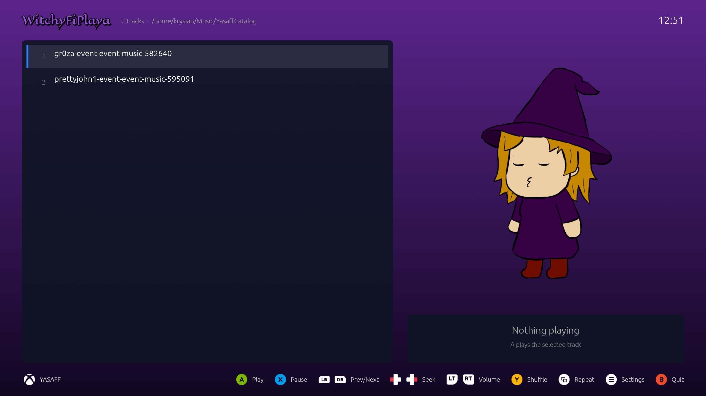

<p align="center">


[](LICENSE)


# WitchyFiPlaya

A simple music player for the couch, used entirely with a game controller. Created dedicated to YASAFF, but works standalone. 


## Supported formats

MP3, FLAC, WAV, OGG Vorbis, M4A/AAC (including ALAC), AIFF, CAF and MKA (`.mka`). Titles, artists and albums come from the files' tags. CAF and MKA files show their file name instead, because their tags can't be read.

## Dancing animations

Instead of the album cover, a character dances to the playing track. The animations are sprite sheets, or folders with one picture per frame, in [`content/`](content/), which ships with the app (next to `bin/` in the package), so you can add your own: drop a sheet or a folder of frames there and describe it in [`content/settings.json`](content/settings.json). The comments in that file explain how sheets are cut into frames, how frame folders are read and how `dancingLogic` picks an animation for each track (by track, random, one after another…). The animation follows the track's position. When nothing plays or the music is paused, the character sleeps instead: `content/sleep.png` (or the sheet `sleepAnimation` names).

## Controls

Xbox and PlayStation controllers both work. The hints at the bottom show the buttons of the controller used last (or always one kind, see Settings). The table names the Xbox buttons; on a PlayStation pad A = Cross, B = Circle, X = Square, Y = Triangle, LB/RB = L1/R1, LT/RT = L2/R2, View = Create (Share), Menu = Options, Guide = PS.

| Action                  | Controller       | Keyboard           |
|-------------------------|------------------|--------------------|
| Move in the list        | D-pad / stick ↑↓ | ↑ ↓, PgUp / PgDn   |
| Play the selected track | A                | Enter              |
| Pause / resume          | X                | Space              |
| Previous / next track   | LB / RB          | [ / ]              |
| Seek −10 s / +10 s      | D-pad / stick ←→ | ← →                |
| Volume down / up        | LT / RT          | − / + (or =)       |
| Shuffle on/off          | Y                | S                  |
| Repeat: all, one, off   | View             | R                  |
| Settings                | Menu             | O                  |
| Choose the music folder | in Settings      | F                  |
| Minimize (back to YASAFF, music keeps playing) | Guide, or its button bottom left | M |
| Quit (back to YASAFF)   | B                | Esc / Backspace    |

In the folder picker:

| Action                     | Controller       | Keyboard           |
|----------------------------|------------------|--------------------|
| Move in the list           | D-pad / stick ↑↓ | ↑ ↓, PgUp / PgDn   |
| Use this folder / open one | A                | Enter              |
| Open the selected folder   | D-pad / stick →  | →                  |
| Go up to the parent folder | D-pad / stick ←  | ←                  |
| Cancel                     | B / Menu         | Esc / Backspace, F |

## Settings

Menu (O on the keyboard) opens them; ↑↓ picks a row, A or ←→ changes it, B or Menu closes them.

- **Music folder**: A opens the folder picker.
- **Background**: the purple gradient, or your own picture (PNG, JPEG or WebP). A opens a picker that starts in your Pictures folder; pick a picture to use it (it covers the window, cropped to fit), or the first row to go back to the gradient.
- **Button prompts**: Automatic (the controller used last), Xbox or PlayStation.
- **Button icons**: Pictures (from [`assets/buttons_prompt_images/`](assets/buttons_prompt_images/), Kenney's input prompts, CC0) or Generated (colored pills drawn by the app).

## Building

You need [Rust](https://rustup.rs/) (stable, 1.88 or newer). On Linux, the sound and controller libraries also need their development packages, for example on Debian/Ubuntu:

```sh
sudo apt install build-essential pkg-config libasound2-dev libudev-dev
```

Then build and run from the project folder:

```sh
cargo run              # debug build, starts the player
cargo build --release  # optimized build: target/release/witchy-fi-playa
cargo test             # runs the tests
```

Run it from the project folder (or keep `content/` next to the binary, or up to four folders above it), otherwise it can't find the dancing animations.

### On Windows

1. Install the [Visual Studio Build Tools](https://visualstudio.microsoft.com/visual-cpp-build-tools/) with the **Desktop development with C++** workload (Rust needs its linker).
2. Install Rust with [rustup-init.exe](https://rustup.rs/) and keep the default `x86_64-pc-windows-msvc` toolchain.
3. In PowerShell or the Command Prompt, in the project folder:

```powershell
cargo run              # debug build, starts the player
cargo build --release  # optimized build: target\release\witchy-fi-playa.exe
cargo test             # runs the tests
```

No extra libraries are needed on Windows. The release build opens without a console window, so error messages only show up in debug builds (`cargo run`).

## Making the installable zip

[`package.sh`](package.sh) builds the release binary and packs everything YASAFF needs into one zip (needs `git` and `zip`):

```sh
./package.sh
```

It prints the path of the result, `dist/witchy-fi-playa-<version>.zip`, which you can install in YASAFF. The zip contains:

- `bin/linux/witchy-fi-playa`: the stripped release binary
- `content/`: the dancing animations and their `settings.json`
- `icon.png`, `rectangle_cover.png`, `square_cover.png`: the icon and the covers YASAFF shows
- `yasaffConfig.json`: the app's description for YASAFF (name, version, how to run it, and the git commit it was built from)

The version comes from `Cargo.toml`; set `VERSION` to override it. To also include Windows, build the `.exe` on Windows (`cargo build --release`) or cross-compile it, then pass its path in `WINDOWS_EXE`:

```sh
VERSION=0.8.1 WINDOWS_EXE=path/to/witchy-fi-playa.exe ./package.sh
```

### On Windows

[`package.ps1`](package.ps1) does the same in PowerShell (Windows PowerShell 5.1 or PowerShell 7), with only Windows tools. Build-wise it needs what [Building on Windows](#on-windows) lists, plus Git. In the project folder:

```powershell
powershell -ExecutionPolicy Bypass -File .\package.ps1
```

It builds the release `.exe` and prints the path of `dist\witchy-fi-playa-<version>.zip`. That zip only runs on Windows (`bin/windows/witchy-fi-playa.exe`). `VERSION` works as with `package.sh`; to add Linux as well, pass a Linux binary built elsewhere (e.g. `cargo build --release` in WSL) in `LINUX_BIN`:

```powershell
$env:VERSION = '0.8.1'
$env:LINUX_BIN = 'path\to\witchy-fi-playa'
powershell -ExecutionPolicy Bypass -File .\package.ps1
```

Remove them again with `Remove-Item Env:VERSION, Env:LINUX_BIN`, or they stay set for the rest of the PowerShell session.

#### With WSL

Alternatively, run `package.sh` in [WSL](https://learn.microsoft.com/windows/wsl/install) (for example Ubuntu). It always builds the Linux binary, so the zip runs on both systems:

1. Build the `.exe` on Windows as described in [Building on Windows](#on-windows): `cargo build --release`.
2. Open the WSL terminal and install Rust, the Linux packages from [Building](#building), `git` and `zip`:

   ```sh
   curl --proto '=https' --tlsv1.2 -sSf https://sh.rustup.rs | sh
   sudo apt install build-essential pkg-config libasound2-dev libudev-dev git zip
   ```

3. Go to the project folder (Windows drives are under `/mnt`, e.g. `C:\Projects\WitchyFiPlaya` is `/mnt/c/Projects/WitchyFiPlaya`) and run the script with the `.exe` from step 1:

   ```sh
   cd /mnt/c/Projects/WitchyFiPlaya
   WINDOWS_EXE=target/release/witchy-fi-playa.exe ./package.sh
   ```

The zip lands in `dist\` in the project folder and runs on both Linux and Windows. If Git checked the script out with Windows line endings and Bash fails with `$'\r': command not found`, run `sed -i 's/\r$//' package.sh` once.

## License

Copyright (c) 2026 naisyrkdev

Witchy-Fi Playa is released under the MIT License. See [LICENSE](LICENSE) for the full text.
